<!--
  ARAVIND R / CYBER-HUD DEVELOPER SYSTEM v2.0
  Custom, locally hosted animated SVGs; no JavaScript or GitHub-unsupported HTML/CSS.
  Place README.md in the repository root and keep /assets together.
-->

<p align="center">
  <picture>
    <source media="(max-width: 650px)" srcset="./assets/hero-mobile.svg" />
    
  </picture>
</p>

<p align="center">
  <a href="https://aravind-r-portfolio.vercel.app/">PORTFOLIO</a>
  &nbsp; / &nbsp;
  <a href="https://www.linkedin.com/in/aravind-r-16b1b4313/">LINKEDIN</a>
  &nbsp; / &nbsp;
  <a href="https://leetcode.com/u/Aravind_R4/">LEETCODE</a>
  &nbsp; / &nbsp;
  <a href="mailto:aravind.rameshrd@gmail.com">EMAIL</a>
</p>

### `> whoami`

I’m **Aravind R**, a final-year **B.Tech Artificial Intelligence & Data Science** student at **Saveetha Engineering College, Chennai** and former **Full Stack Developer Intern at ApproTech**. I build secure, scalable backend systems and full-stack applications with **Java, Spring Boot, React.js, and SQL**, and I’m actively engineering **Agentic AI, LangGraph, and RAG** automation platforms.

```text
aravind@dev:~$ ./current_focus

[ BUILDING ]  Multi-tenant SaaS & Agentic AI telecom operations (NetOps AI)
[ STACK ]     Java • Spring Boot • Spring Security • React.js • Docker • AWS
[ PRACTICING ] Data Structures & Algorithms (Java) • System Design (HLD / LLD)
[ APPROACH ]  Learn → Design → Build → Optimize
```

### `> ls ./shipped-systems`

<a href="https://github.com/ARAVIND23005370/Multi-Tenant-SaaS-Platform.git"></a>

**Multi-Tenant SaaS Workspace Platform** — A multi-tenant SaaS application with strict tenant isolation, tenant-aware authorization, RBAC, subscription management, audit logging, API rate limiting, and real-time collaboration using WebSockets and Redis.  
**Stack:** `Java` `Spring Boot` `Spring Security` `React.js` `PostgreSQL` `Redis` `WebSocket` `Docker`  
**↗ [VIEW REPOSITORY](https://github.com/ARAVIND23005370/Multi-Tenant-SaaS-Platform.git)**

<br/>

<a href="https://e2edocs.vercel.app/"></a>

**DocFlow — End-to-End Document Intelligence & Decision Automation** — A full-stack OCR document processing platform with JWT authentication, RBAC, dynamic `APPROVE / REVIEW / REJECT` rule routing, asynchronous processing, analytics, and PDF/CSV reporting.  
**Stack:** `Java 17` `Spring Boot` `JWT` `React.js` `MySQL` `OCR` `Docker`  
**↗ [VIEW REPOSITORY](https://github.com/ARAVIND23005370/End-to-End-Document-Workflow-Automation)**

<br/>

<a href="https://github.com/ARAVIND23005370/netops-ai.git"></a>

**NetOps AI — Agentic AI Telecom Network Operations Platform *(In Development)*** — An AI-driven platform for telecom network anomaly detection, alert correlation, evidence-driven root cause analysis, RAG documentation retrieval, and LangGraph agent remediation with human approval.  
**Stack:** `Python` `FastAPI` `PostgreSQL` `Scikit-learn` `LangGraph` `RAG` `React.js`  
**↗ [IN DEVELOPMENT](https://github.com/ARAVIND23005370/netops-ai.git)**

<br/>

<a href="https://banking-system-web.vercel.app/login"></a>

**AI Resume Analyzer** — An NLP-based resume screening application using TF-IDF vectorization and cosine similarity scoring to evaluate job-description compatibility, validated across 50+ test resumes.  
**Stack:** `Python` `NLP` `TF-IDF` `Cosine Similarity` `Streamlit`  
**↗ [VIEW REPOSITORY](https://github.com/ARAVIND23005370/AI-Resume-Analyzer)**

<br/>


**Banking Management System** — A full-stack banking application built around Spring Security, JWT authentication, account management, deposits, withdrawals, fund transfers, and relational transaction history.  
**Stack:** `Java` `Spring Boot` `Spring Security` `JWT` `MySQL` `React.js`  
**↗ [VIEW REPOSITORY](https://github.com/ARAVIND23005370/Banking-Management-System.git)**

### `> cat ./toolkit.yml`

<p align="center">
  <picture>
    <source media="(max-width: 650px)" srcset="./assets/skills-mobile.svg" />
    
  </picture>
</p>

### `> cat ./experience-and-credentials.log`

* **Full Stack Developer Intern — ApproTech *(Jul 2025)***: Built 5+ Java/Spring Boot REST APIs, implemented Spring Security with JWT, tested 10+ endpoints via Postman in Agile sprints, and optimized MySQL queries (~30% faster response time).
* **Certifications**: Oracle SQL Certified Specialist · JPMorgan Chase SWE (Forage) · IBM Software Engineering · Microsoft Azure / AI Learning Challenge · NPTEL IoT (Elite) · PyTorch Ultimate.
* **Hackathons**: Google Gen AI Exchange Hackathon (Google Cloud × Hack2Skill) · Hack Hustle Hackathon.

### `> read ./github-telemetry`

<details>
  <summary><b>OPEN LIVE GITHUB TELEMETRY</b> — stats, language mix &amp; contributions</summary>
  <br />
  <p align="center">
    
    
  </p>
  <p align="center">
    
  </p>
</details>

### `> ping aravind --connect`

If you’re hiring for software engineering roles, building scalable systems, or exploring Agentic AI, I’d love to connect.

**[GITHUB](https://github.com/ARAVIND23005370)** · **[LINKEDIN](https://www.linkedin.com/in/aravind-r-16b1b4313/)** · **[PORTFOLIO](https://aravind-r-portfolio.vercel.app/)** · **[LEETCODE](https://leetcode.com/u/Aravind_R4/)**

<p align="center">
  <a href="https://aravind-r-portfolio.vercel.app/">
    
  </a>
</p>

<!-- Built for Aravind R (ARAVIND23005370). -->
