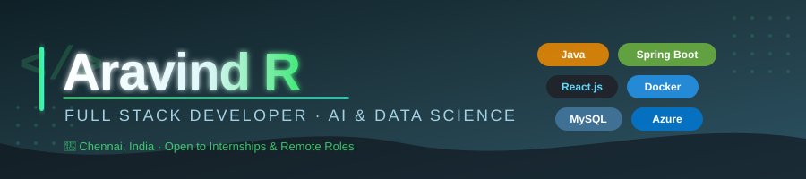

# 👋 Hey, I'm Aravind R

<div align="center">



### Software Engineer | Java Full Stack Developer | AI Enthusiast

[](https://git.io/typing-svg)

<br/>

<a href="https://aravind-r-portfolio.vercel.app/">

</a>
<a href="https://www.linkedin.com/in/aravind-r-16b1b4313/">

</a>
<a href="https://leetcode.com/u/Aravind_R4/">

</a>
<a href="mailto:aravindgd45@gmail.com">

</a>

<br/><br/>


</div>

---

##  About Me

I'm an **Artificial Intelligence & Data Science undergraduate at Saveetha Engineering College**, passionate about building software that solves real-world problems.

My primary focus is **Java Full Stack Development**, with a strong interest in backend engineering, scalable application architecture, and intelligent systems.

I enjoy working across the development lifecycle — from designing REST APIs and database schemas to implementing secure authentication and building responsive frontend applications.

-  Building full-stack applications using Java, Spring Boot and React.
-  Interested in backend architecture, application security and system design.
-  Practicing Data Structures & Algorithms and solving coding challenges.
-  Exploring Artificial Intelligence, Machine Learning and intelligent automation.
-  Focused on becoming a strong software engineer through hands-on development.

###  My Developer Identity

```java
public class Aravind {

    String name = "Aravind R";
    String role = "Java Full Stack Developer";

    String[] currentlyLearning = {
        "System Design",
        "Advanced Spring Boot",
        "Cloud & DevOps",
        "Data Structures & Algorithms"
    };

    String[] interests = {
        "Backend Engineering",
        "Artificial Intelligence",
        "Scalable Systems",
        "Problem Solving"
    };

    String mindset = "Learn. Build. Improve. Repeat.";
}
```

---

##  Technology Stack

<div align="center">

### Languages & Core Development


### Backend & Frameworks


### Databases & Messaging


### Cloud, DevOps & Tools


</div>

---

##  Featured Projects

### 01. Multi-Tenant SaaS Workspace Platform

**Java · Spring Boot · Spring Security · React.js · PostgreSQL · Redis · WebSocket · Docker**

A multi-tenant SaaS application designed to allow multiple organizations to manage their workspaces securely within a shared platform.

**Key Engineering Features**

- Strict tenant isolation and tenant-aware authorization.
- Role-Based Access Control (RBAC).
- Workspace and subscription management.
- Redis-backed real-time collaboration.
- Audit logging and API rate limiting.
- Secure authentication and authorization.

[](https://github.com/ARAVIND23005370)

---

### 02. DocFlow – Document Intelligence & Decision Automation

**Java 17 · Spring Boot · REST APIs · MySQL · OCR · Rule Engine**

An intelligent document workflow system that extracts information from documents, evaluates predefined business rules, and automates decision routing.

**Key Engineering Features**

- Document ingestion and OCR-based information extraction.
- Automated rule-based evaluation.
- Modular document processing architecture.
- Workflow-based decision routing.
- Reusable processing components for different document categories.

[](https://github.com/ARAVIND23005370/End-to-End-Document-Workflow-Automation)

---

### 03. AI Resume Analyzer

**Python · NLP · Streamlit**

An AI-powered application that analyzes resumes, extracts relevant skills and keywords, and evaluates compatibility with job descriptions.

**Key Features**

- Resume parsing and text extraction.
- NLP-based skill identification.
- Keyword matching and compatibility scoring.
- Automated resume analysis.

[](https://github.com/ARAVIND23005370/AI-Resume-Analyzer)

---

### 04. Banking Management System

**Java · Spring Boot · Spring Security · JWT · MySQL · React**

A full-stack banking application focused on secure user authentication, account management and backend-driven operations.

**Key Features**

- Secure authentication using Spring Security and JWT.
- RESTful backend architecture.
- Database-driven account management.
- React-based user interface.

[](https://github.com/ARAVIND23005370)

---

##  Experience

### Full Stack Developer Intern — ApproTech

<sub>July 2025</sub>

Worked on full-stack development using Java, Spring Boot, React.js and MySQL.

**Responsibilities & Contributions**

- Developed RESTful APIs using Java and Spring Boot.
- Built reusable frontend components using React.js and Hooks.
- Designed relational database schemas.
- Implemented authentication and authorization using Spring Security and JWT.
- Performed API testing using Postman.
- Collaborated through Agile development workflows.

---

##  GitHub Analytics

<div align="center">


<br/><br/>


</div>

### Contribution Activity

<div align="center">


</div>

---

##  Certifications & Achievements

| Certification | Organization |
|---|---|
| Oracle SQL Certified Specialist | Oracle |
| Internet of Things – Elite Grade | NPTEL |
| PyTorch Ultimate | Coursera |
| AI Learning Challenge | Microsoft |
| Software Engineering Virtual Experience | JPMorgan Chase – Forage |
| Software Engineering Fundamentals | IBM |
| Gen AI Exchange Hackathon | Google Cloud × Hack2Skill |

---

##  Current Focus

- Building production-oriented full-stack applications.
- Strengthening Java, Spring Boot and backend engineering.
- Practicing DSA for software engineering interviews.
- Learning High-Level Design (HLD) and Low-Level Design (LLD).
- Exploring AI engineering and intelligent automation.
- Improving cloud deployment and DevOps skills.

---

##  Let's Connect

<div align="center">

### Have an interesting project or opportunity?

I'm interested in connecting with developers, engineers, recruiters and people building innovative products.

<br/>

<a href="https://www.linkedin.com/in/aravind-r-16b1b4313/">

</a>

<a href="mailto:aravind.rameshrd@gmail.com">

</a>

<a href="https://aravind-r-portfolio.vercel.app/">

</a>

<br/><br/>

*"Code with purpose. Build with passion. Engineer for impact."*

<br/>


</div>
